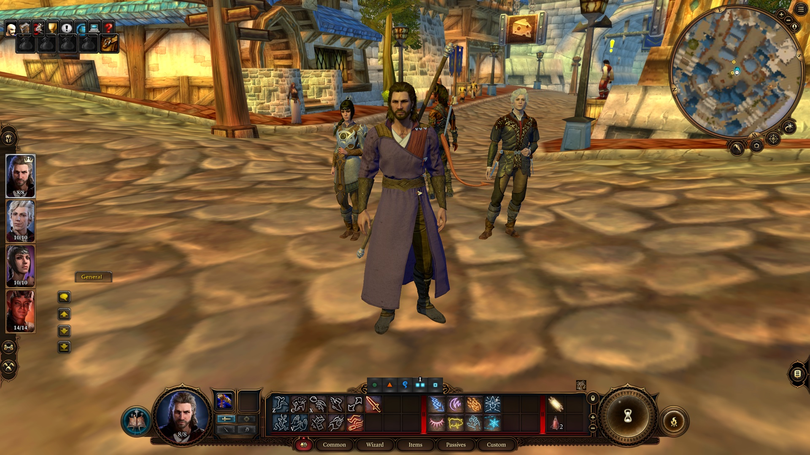
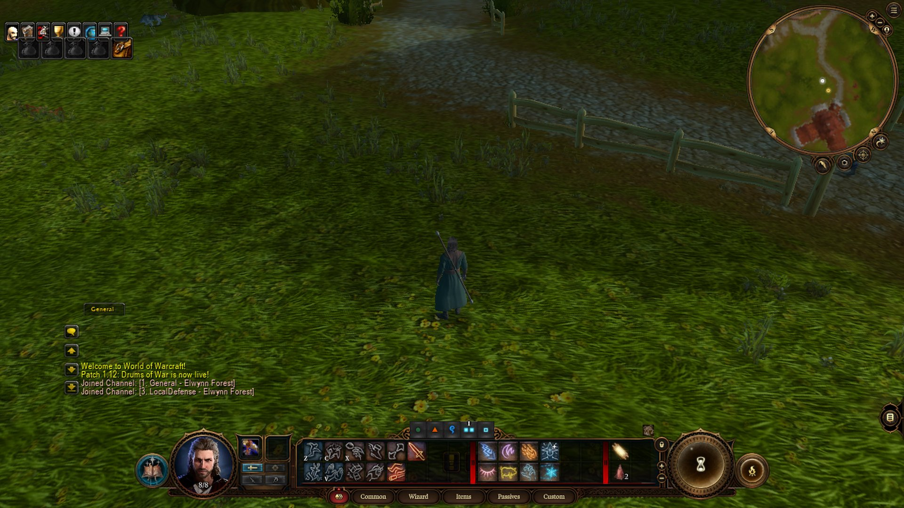

# WoW-BG3 Passthrough Mod



Play vanilla World of Warcraft (1.12.1) as the world of a Baldur's Gate 3 game: your BG3 party walks WoW's world and fights its mobs with BG3's rules, turns and spells. Under the hood, a custom build of the Script Extender connects BG3 to a modified benilla client running hidden in the background, which streams WoW's world into BG3: the picture, walkable ground, walls and mobs. BG3 saves keep the WoW side too.

Bring your own copies of BG3 and WoW.

> **State: WIP WIP WIP WIP WIP.** You can make a character, fight mobs, quest, loot, trade, level up and recruit companions, but a lot is untested, unbalanced or not built yet. I am just a dude with a fulltime day job, there is only so many scenarios I can test lol.
>
> Updates may break older saves, so keep that in mind before you start a long game. This is a fan project. It isn't affiliated with Blizzard Entertainment, Larian Studios or Wizards of the Coast, and you need to own both games.

> **Photosensitivity and epilepsy warning.** This is a work-in-progress mod that modifies graphic pipelines. There is a chance graphics break and cause screen flashing.




## The goal

A proper, actual, for real, playable WoW 1 to 60 experience with the BG3 characters and BG3's combat and mechanics. I want this to be more than just some sort of tech demo, but a proper full game experience instead.

## Requirements

| What | Notes |
| --- | --- |
| Linux (Windows and Mac coming Soon™) | x86_64, with Steam from your distribution or Valve (Flatpak Steam isn't supported) |
| Baldur's Gate 3 | The native Linux build from Steam, not the Windows build under Proton |
| World of Warcraft 1.12.1 | Your own client: build 5875, English |
| Disk space | About 15 GB free: your WoW client (about 5 GB) and up to about 10 GB the mod builds from it |
| Internet | Once, at the first start (a 48 MB download): the WoW server's world database (every NPC, quest, item and spawn). It's Blizzard-derived, so the mod can't ship it, and it isn't in your WoW client either, so it's fetched from vmangos' public sources and checked against checksums. Nothing is sent anywhere |

Tested only on:

- Fedora 44 (KDE), AMD Ryzen 7 9800X3D, AMD Radeon RX 9070 XT (Mesa 25.0 and 26.2)
- Linux Mint (X11), Nvidia RTX 4070 Ti (driver 595.99)

Intel graphics are untested.

## What (mostly) works

- **Starting.** Enable WoW-BG3 Passthrough in BG3's mod manager and start a New Game. Make or pick your character in BG3's character creation; you land in the WoW start zone based on this table:

  | BG3 race | WoW race | Faction | Start zone |
  | --- | --- | --- | --- |
  | Human, Half-Elf | Human | Alliance | Elwynn Forest |
  | Elf | Night Elf | Alliance | Teldrassil |
  | Dwarf | Dwarf | Alliance | Dun Morogh |
  | Gnome, Halfling | Gnome | Alliance | Dun Morogh |
  | Half-Orc | Orc | Horde | Durotar |
  | Githyanki | Troll | Horde | Durotar |
  | Tiefling, Drow | Undead | Horde | Tirisfal Glades |
  | Dragonborn | Tauren | Horde | Mulgore |
- **Exploring.** BG3's camera, controls and interface; WoW's world under your feet, with WoW's NPCs, mobs, day and night. WoW's UI is mostly hidden. Some WoW options are still available at the top left in case something goes wrong. (Indoor movement and camera can be a little whack.) You may split the party and disperse around the world without limit.
- **Fighting.** Turn based with BG3's spells and rules. You can attack friendly NPCs too. Sneaking and surprise attacks work too. You can enable turn-based mode outside of a fight to stop time too.
- **Looting.** A WoW corpse opens BG3's own loot window with that mob's WoW loot and gold.
- **Questing and NPCs.** Talking to a quest giver, or to any NPC with WoW dialog, opens WoW's own quest and gossip windows, as in vanilla: accept, decline and hand in there. Vendors open BG3's trade screen with the vendor's WoW wares. A left click on a friendly NPC talks to it while you walk and pickpockets it while you sneak.
- **Money.** All WoW money is turned into BG3's:

  | WoW | BG3 |
  | --- | --- |
  | 1 copper | 1 gold |
  | 1 silver | 100 gold |
  | 1 gold | 10,000 gold |
- **Vendors (mostly).** Vendors have a limited stock and a purse that restock upon long rest. BG3's attitude and Persuasion apply. You can pickpocket them, and they get mad if you fail. (WoW's arrows are replaced with BG3's special arrows instead.)
- **Map and waypoints.** Use M to open the map and use the waypoints as needed. The WoW flight points you have discovered act as waypoints: free, and no flight master needed after discovering one. Ships and zeppelins are replaced by a placeholder NPC for now.
- **Dying and saving.** No WoW corpse run, you just reload your last save like in BG3. Save and load *should* work as expected.

## Levelling

You earn XP the WoW way (kills, quests, exploration):

| Level | What you get |
| --- | --- |
| 1 | Your character alone |
| 2, 3, 4 | One more party slot each, grab them from camp. |
| 5 to 60 | One BG3 level-up each, two at WoW levels 18, 32, 46 and 60. |

**Your characters do not all level together.** Unlike vanilla BG3, one level is one level-up for one character of your choice, not a level for the whole party.

A dismissed companion keeps its BG3 levels and rejoins at them; the pool counts them as spent. Only Withers' respec gives level-ups back.

## Planned

- Mac and Windows versions coming Soon™, fixing other visual jank in Linux. LLMs kinda suck at dealing with graphics and telling what looks bad or incorrect.
- Equipment with more interesting effects than just stats.
- More custom-made content/scripts where mapping rules are not enough, like dungeons.
- Proper balance and pacing for the whole 1 to 60 journey.
- Increased BG3's level cap from 12 to 16, reachable at the equivalent of level 60 in WoW, with new custom-made abilities based on WoW's for those and previous levels for all classes.

## Known issues

I am a dude with a full time day job, so there is likely a sh\*t load more of issues that I just don't have the time to test. Both WoW and BG3 have a LOT of content.

- Loading times can be a bit much (especially on first start) since the game has to build the level on your PC from your WoW client in real time.
- Sometimes you can "see through" to the hidden BG3 world and NPCs.
- Some spell effects may be missing, only partly drawn, or incorrectly drawn.
- Balance and pacing are a first guess, not tuned yet.
- Sometimes, light on the characters may not look correct (like in Orgrimmar).
- Mostly tested on start zones.
- Haven't tested custom bindings or a controller yet.
- A party can't be split across continents: moving to the other continent brings the whole party along.
- Ships and zeppelins can't be boarded; there is a placeholder NPC in the meantime.
- Lots of items aren't mapped to their BG3 equivalents yet or given a script (like Hearthstone).
- I DON'T KNOW WHAT TO DO WITH WATER. You can swim in WoW but you can't in BG3. Some manual/custom edits may need to be done to water sections. Currently characters just Jesus-walk on top of water. Ideas on this are very welcome.
- The camera ignores collision and can show odd views.
- Cities and other buildings may not have proper walkable spots, needs manual fixing.
- A save made in a fight ends that fight when loaded.
- Robbed NPCs sometimes don't look around for the thief.
- Lifts and the Deeprun Tram work but may be a bit janky.
- Many, many more...

More in: [docs/known-issues.md](docs/known-issues.md).

**If something breaks:** type `/wowbg3 report` in chat, then open an [issue](https://github.com/sebastianlofi/wow-bg3-passthrough/issues), say what you were doing, and attach the newest `WOW-BG3-report-<time>.zip` from `Mods/WOW-BG3/data/reports/`. It holds the logs and crash data; your home folder, user name and PC name are masked.

## FAQ

**Windows? Mac?**

Soon™

**How are item stats or abilities decided?**

By rules, mostly automatic. A WoW weapon keeps its BG3 base weapon's damage die and gets +1 to +3 from its WoW damage per second; armour gets BG3-style AC from its armour type and item level; WoW stats become ability and resistance bonuses, and many on-equip and on-use effects are mapped too. A WoW mob gets BG3 versions of the spells it casts in WoW, from a rules file you can extend (see [Looking to contribute?](#looking-to-contribute)).

Any feedback or ideas for this are appreciated!

**Multiplayer?**

Eventually, it would work like BG3's (up to 4 players sharing the same party) and not like WoW's (i.e. no MMO version of this).

**The Burning Crusade or Wrath of the Lich King?**

Maybe, the idea is to have a proper stable version of vanilla first. It's a lot more content to tune and fix than I originally thought, so I wanna stick with this scope until it is in a place I am happy with before trying the other expansions. Feel free to fork and give it a try if you want to tackle that though!

**WoW: Forever's shaders for water, fog and light?**

Perhaps a recreation of them of sorts. Low priority though, so if I haven't pulled all my hair out by the time I am happy with the mod, I could look into it.

## Commands

Type them in WoW's chat:

| Command | What it does |
| --- | --- |
| `/wowbg3 list` | The party and where everyone is |
| `/wowbg3 add NAME` | Recruit a companion: shadowheart, astarion, laezel, wyll, karlach, gale, jaheira, minsc, halsin, minthara |
| `/wowbg3 remove NAME` | Dismiss a companion (it keeps its BG3 levels) |
| `/wowbg3 pool` | Your WoW level, party slots and BG3 level-ups left |
| `/wowbg3 respec NAME` | Withers' respec: back to BG3 level 1, its level-ups back to the pool |
| `/wowbg3 waypoint`, `waypoint go NAME` | The flight points you have discovered; travel to one |
| `/wowbg3 chat on`, `off` | Show or hide WoW's chat |
| `/wowbg3 refill` | HP, spell slots, rage and the rest back to full |
| `/wowbg3 tp PLACE`, `tp ZONE X Y`, `tp X Y` | Move on the WoW map (X and Y from 0 to 100, as on WoW's map). Examples: `/wowbg3 tp goldshire` (a named place), `/wowbg3 tp elwynn 42 65` (a zone and a map spot), `/wowbg3 tp 50 50` (a spot in the zone you're in) |
| `/wowbg3 faction horde`, `alliance`, `own` | Your faction (Horde or Alliance), kept in each save |
| `/wowbg3 time day`, `night`, `dawn`, `dusk`, `HH:MM`, `now` | Hold the world's light at that time, until `now` or the next start of the game. The server's clock does not change |
| `/wowbg3 level N` | Set your level, 1 to 60 |
| `/wowbg3 xprate N` | The server's XP rate (1 is normal) |
| `/wowbg3 learn SPELL`, `unlearn SPELL` | Give your hero a BG3 spell by its stats name (`Target_Grease`), or take it back |

## Install

Download `WOW-BG3-0.1.0.zip` from this repository's [Releases page](https://github.com/sebastianlofi/wow-bg3-passthrough/releases); the README in it has every step. In short:

1. Unpack the zip into BG3's Mods folder, usually `~/.local/share/Larian Studios/Baldur's Gate 3/Mods/`, and copy your WoW 1.12.1 client into `WOW-BG3/WoW/`, so it looks like this:

   ```
   Mods/
   ├── WOW-BG3.pak
   └── WOW-BG3/
       ├── bg3le/
       ├── settings.conf
       ├── ...            (the rest of the zip's WOW-BG3 folder)
       └── WoW/           <- your WoW 1.12.1 client goes here
           ├── Data/
           └── WoW.exe
   ```
2. With Steam closed, run once: `python3 ~/.local/share/"Larian Studios/Baldur's Gate 3/Mods/WOW-BG3/bg3le/install.py"`. It installs the Linux Script Extender (bg3le) with WOW-BG3's patches and sets BG3's Steam launch option. It still runs your other Script Extender mods; `--uninstall` undoes it. Steam installed as a Flatpak isn't supported by the installer yet: use Steam from your distribution's packages or Valve's own.
3. Start BG3, enable WoW-BG3 Passthrough in the mod manager, start a New Game.

**The first time you start a game will take some time** and needs the internet once: the local WoW server builds its data from your WoW files and downloads its world database (about 48 MB, from vmangos' public sources; this mod ships no game data). Later starts and loads take under a minute and need no internet. Switching WoW-BG3 Passthrough off in the mod manager stops the whole WoW side.

> **Experimental:** make backups of your existing saves before installing!

Why the download: the WoW server needs a world database (every NPC, quest, item, vendor and spawn). It is Blizzard-derived, so it fetches it from vmangos' public sources (the WoW server this mod uses), at a pinned version, and checks every file against the checksums that ship with the mod (`server/sql.lock`) before using it. Nothing else is downloaded, and nothing is sent anywhere.

To update, replace `WOW-BG3.pak` and `WOW-BG3/` with the new ones (keep your `WoW/` folder, your `settings.conf` and the `data/` folder, where the mod keeps its server, snapshots and logs) and run the installer again. Your saves stay.

More: [docs/install.md](docs/install.md). Known issues of this version: see [Known issues](#known-issues) above.

**Uninstalling:** switch WoW-BG3 Passthrough off in the mod manager and close BG3, run the installer with `--uninstall` (it lives inside the mod's folder, so before you delete it), then delete `Mods/WOW-BG3.pak` and `Mods/WOW-BG3/`.

## What it puts on your PC

Everything the mod makes stays in `Mods/WOW-BG3/`, apart from the Script Extender in `~/.local/share/bg3le/` and BG3's Steam launch option, which `--uninstall` takes back out. The WoW server runs on your own machine only, and nothing is sent anywhere. Full details (disk use, network, processes): [docs/install.md](docs/install.md).

## Building from source

Every part of the release zip is built from this repository plus pinned upstream sources: `release/build-all.sh` (version 0.1.0 unless given). What it needs and what each step does: [docs/build.md](docs/build.md).

| Folder | What it is |
| --- | --- |
| `mod/` | The BG3 mod (Script Extender Lua, `meta.lsx`), packed into `WOW-BG3.pak` |
| `plugins/` | bg3le native plugins: the launcher, the main plugin (`wowbg3.so`), the render plugin, the quest cursor plugin; `plugins/capture/` is the render code they share |
| `bridge/` | The fight bridge (Rust crate `wow-bg3-link`) between BG3's fights and the WoW server |
| `tools/` | The Python tools the release runs: coordinator, save sync, world, inventory and chat bridges, data generators |
| `wow-addon/` | The WoW interface addon used in world mode |
| `server/` | The portable WoW server: start script and build scripts |
| `patches/` | Patches to the upstream projects WOW-BG3 builds: bg3le, benilla, vmangos (each under its upstream licence) |
| `release/` | The release build: zip builder, player README, launcher config, licence collector, build settings |
| `docs/` | Install, build, architecture, known issues |
| `LICENSES/`, `THIRD-PARTY-NOTICES.md` | Licences of the bundled third-party parts |

## Looking to contribute?

Hand-made mob abilities are the easiest place to start: which BG3 spells a WoW mob gets comes from a JSON rules file you can extend with your own boss fights or mob packs, no code needed. How it works, with an example: [docs/mob-abilities.md](docs/mob-abilities.md). Bug reports, balance notes and pull requests are welcome too.

## Licence

MIT ([LICENSE](LICENSE)). The upstream parts the release bundles or patches (vmangos, benilla, bg3le, MariaDB, Python) keep their own licences ([THIRD-PARTY-NOTICES.md](THIRD-PARTY-NOTICES.md)); bg3le's Commons Clause means WOW-BG3 releases may not be sold.

WOW-BG3 is not affiliated with or endorsed by Blizzard Entertainment or Larian Studios. World of Warcraft is a trademark of Blizzard Entertainment, Inc.; Baldur's Gate is a trademark of its owner (Wizards of the Coast, whose game Larian Studios develops). This project contains no Blizzard or Larian files.
