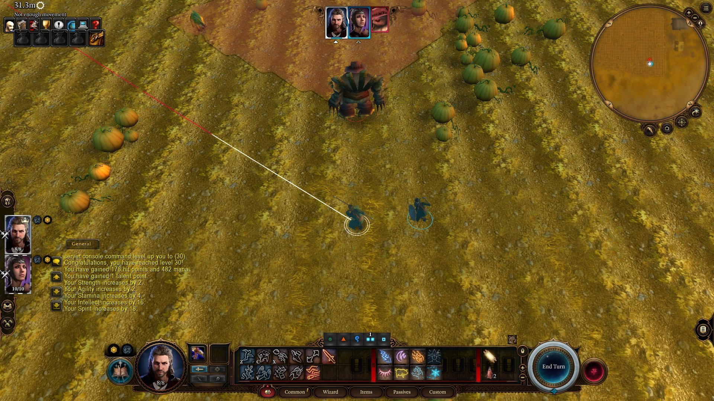
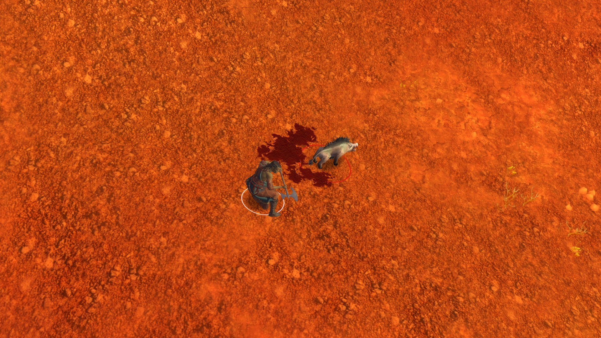

# WOW-BG3 Passthrough

Play vanilla World of Warcraft (1.12.1) as the world of a Baldur's Gate 3 game.

Your BG3 party walks WoW's world. WoW's mobs, NPCs, quests and loot are real WoW, served by a
local WoW server on your own machine; fights against WoW's mobs are BG3 fights with BG3's rules,
turns and spells. BG3 saves keep the WoW side too.

Linux only, with the native Linux build of BG3 from Steam. It needs your own WoW 1.12.1 client:
this project contains no Blizzard or Larian files.

The mod itself is called WOW-BG3: that is the name in BG3's mod manager, and in its files and folders.

> **State: very much a work in progress.** 0.1.0 is a first playable beta. You can make a character,
> walk Elwynn Forest, fight its mobs, quest, loot, trade, level up and recruit companions, but a lot
> is untested, unbalanced or not built yet. [What is work in progress](#work-in-progress) lists it
> honestly; read it before you start a long game.

> **Photosensitivity and epilepsy warning.** This is a work-in-progress mod. When the passthrough
> between WoW and BG3 glitches, the screen can flash suddenly, including bright white flashes. If
> you or anyone watching has photosensitive epilepsy or is sensitive to flashing lights, be careful
> playing it. Stop right away if you feel unwell.

## The goal

A fully playable WoW 1 to 60 experience with the BG3 characters and BG3's combat: WoW's world,
quests, items, zones and progression, played with BG3's party, turn-based fights, spells, dialogue
of the companions and its look. WoW's stats and mechanics are mapped onto BG3's: most of it by
broad automatic rules (items, mobs, health, levels), and some of it hand-made where a rule cannot
do a thing justice, dungeon bosses for example.

After that: multiplayer, and then The Burning Crusade and Wrath of the Lich King once the vanilla
version is mostly complete.

## How it plays

- **Starting.** Enable WOW-BG3 in BG3's mod manager and start a New Game. Make or pick your
  character in BG3's character creation; you land in the WoW start zone of your character's race.
- **Exploring.** BG3's camera, controls and interface; WoW's world under your feet, with WoW's
  NPCs, mobs, day and night. WoW's chat, quest log and quest tracker sit beside BG3's interface.
- **Fighting.** Walk into a WoW mob (or attack one) and a BG3 fight starts: the mob is held on the
  WoW server and fights as a BG3 creature, turn by turn, with BG3's rules. When the fight ends the
  result goes back to WoW as real damage, XP, loot and quest credit.
- **Looting.** A WoW corpse opens BG3's own loot window with that mob's WoW loot and gold.
- **Questing and NPCs.** Talking to a quest giver, or to any NPC with WoW dialog, opens WoW's own
  quest and gossip windows, as in vanilla: accept, decline and hand in there. Vendors open BG3's
  trade screen with the vendor's WoW wares. A left click on a friendly NPC talks to it while you
  walk and pickpockets it while you sneak; NPCs with nothing to say in WoW (guards, villagers) offer
  no Talk. A robbed NPC and its neighbours search around where you stood before going back to their
  posts.
- **Money.** WoW's copper is BG3's gold: 1 copper = 1 gold, so 1 silver = 100 gold and 1 WoW gold
  = 10,000 gold. Prices and corpse money use the same rule. Merchants show food and arrows as the stacks WoW sells, and you can split a
  stack to buy or sell just part of it. With no discount on the barter screen, a merchant charges WoW's
  buy price and pays WoW's sell price, on every difficulty. BG3's attitude and Persuasion move both from
  there, and the price the screen shows is the price you pay: WoW's money follows. BG3's item values are whole
  numbers, so a buy price can show up to 1 copper off WoW's (a 1 copper item shows 3 on Balanced); sell prices
  are exact. A merchant shows 4,000,000 gold during a trade, since WoW's vendors never run out. Inside an opened bag,
  such as the Camp Supply Sack, BG3's tooltip shows the item's plain value, not the trade price; the sale still pays
  the right price. What WoW won't buy (no sell price) stays with you. WoW's reputation discount shows in the base price.
- **Waypoints.** The WoW flight points you have discovered are BG3's waypoints: click one in BG3's waypoint panel or
  its pin on the map, or `/wowbg3 waypoint go NAME`. Free, no flight master needed, on either continent; Ironforge
  and Undercity too. Not in a fight, on a flight, dead, or at camp. `waypoints = 0` in `settings.conf` turns it off.
- **Saving.** Save and load as in BG3; loading a save takes the WoW character back to where it was
  in that save. World mode only happens in games started with WOW-BG3 enabled: a save made without
  it plays as plain BG3, and WOW-BG3 says so in a message box when you load one.

## Your character in WoW

A hidden WoW character follows your BG3 character, made for you at the first start (no WoW account
or login is needed: everything is local). Its race, and with it the start zone and the faction,
come from your BG3 race:

| BG3 race | WoW race | Faction | Start zone |
|---|---|---|---|
| Human, Half-Elf, Halfling | Human | Alliance | Northshire (Elwynn Forest) |
| Elf | Night Elf | Alliance | Shadowglen (Teldrassil) |
| Dwarf | Dwarf | Alliance | Coldridge Valley (Dun Morogh) |
| Gnome | Gnome | Alliance | Coldridge Valley (Dun Morogh) |
| Half-Orc | Orc | Horde | Valley of Trials (Durotar) |
| Githyanki | Troll | Horde | Valley of Trials (Durotar) |
| Tiefling, Drow | Undead | Horde | Deathknell (Tirisfal Glades) |
| Dragonborn | Tauren | Horde | Camp Narache (Mulgore) |

An origin character goes by the same table, through their race:

| Origin | BG3 race | WoW race and class | Faction | Start zone |
|---|---|---|---|---|
| Gale | Human | Human Mage | Alliance | Northshire (Elwynn Forest) |
| Wyll | Human | Human Warlock | Alliance | Northshire (Elwynn Forest) |
| Shadowheart | Half-Elf | Human Priest | Alliance | Northshire (Elwynn Forest) |
| Astarion | Elf | Night Elf Rogue | Alliance | Shadowglen (Teldrassil) |
| Lae'zel | Githyanki | Troll Warrior | Horde | Valley of Trials (Durotar) |
| Karlach | Tiefling | Undead Warrior | Horde | Deathknell (Tirisfal Glades) |
| The Dark Urge | Your pick | By the race you pick | By race | By race |

The WoW class follows your BG3 class where vanilla allows that race and class together, and
otherwise the closest one it does allow (Warrior is legal for every race):

| BG3 class | WoW class | Where vanilla does not allow it |
|---|---|---|
| Barbarian, Fighter, Monk | Warrior | |
| Ranger | Hunter | Warrior for Human, Gnome and Undead |
| Rogue, Bard | Rogue | Warrior for Tauren |
| Cleric | Priest | Shaman for Orc and Tauren, Warrior for Gnome |
| Wizard, Sorcerer | Mage | Warlock for Orc, Warrior for Night Elf, Dwarf and Tauren |
| Warlock | Warlock | Warrior for Night Elf, Dwarf, Troll and Tauren |
| Druid | Druid (Night Elf, Tauren) | Shaman for Orc and Troll, Priest for Human, Dwarf and Undead, Warrior for Gnome |
| Paladin | Paladin (Human, Dwarf) | Shaman for Orc, Troll and Tauren, Warrior for the rest |

The WoW class matters little in play: your party fights with its BG3 classes.

Northshire and Elwynn Forest are where it has been played most; the other start zones, the Horde
side above all, have had little or no testing.

## Levelling

BG3's own XP is off. Your **WoW** character earns XP the WoW way (kills, quests, exploration; the
local server runs at normal WoW rates), and WoW levels turn into BG3 levels:

| WoW level | What you get |
|---|---|
| 1 | Your character alone |
| 2, 3, 4 | One more party slot each: a party of four at WoW level 4 |
| 5 to 60 | One BG3 level-up each, two at every 5th (5, 10 and on to 60): 68 in all |

**Your characters do not all level together.** One WoW level is one level-up for one character of your choice, not a level
for the whole party, so going from BG3 level 3 to 4 across a party of four takes four level-ups.

Each WoW level from 5 on puts one BG3 level-up into a **pool**, every 5th WoW level two. While the pool holds one, BG3's own
Level Up button shows on every party member who can take it; level whichever one you want (every
class choice is yours), and the others' buttons go once the pool is empty. So members sit at different
BG3 levels on purpose. 68 level-ups take a party of four from BG3 level 1 to 18, so **WoW 60 is a party
of four at BG3 level 18**, and all four can be at 17 from WoW 57.

**WoW levels run to 60, the end goal.** The level BG3 shows beside a character is that character's own BG3
level, not your WoW level:

| WoW level | Level-ups earned | A party of four at BG3 level |
|---|---|---|
| 5 | 2 | 1 to 2 |
| 10 | 8 | 3 |
| 20 | 20 | 6 |
| 30 | 32 | 9 |
| 40 | 44 | 12 |
| 50 | 56 | 15 |
| 57 | 64 | 17 |
| 60 | 68 | 18 |

**The goal past level 12.** BG3 stops at level 12, which a party of four reaches around WoW 40. The idea is to unlock the levels
past 12 for all four, so the party keeps growing all the way to WoW 60, and to add new spells for those new levels. That is still
to come: for now, level-ups past 12 wait in the pool unless you add a level mod (see "What you need").

BG3's XP bar on your character shows how far you are into your current WoW level, and its tooltip says how the
levels work. A small notice gives your WoW level, the level-ups waiting and what the next WoW level gives at each new
WoW level, and `/wowbg3 pool` lists it all.

- **We strongly recommend a level mod.** BG3 itself stops at level 12, and WOW-BG3 does not bundle levels
  past it. Without a level mod, level-ups past 12 stay in the pool and a popup tells you which mods unlock
  more. Install these yourself from Nexus Mods; WOW-BG3 still keeps its own cap of 18:
  - A level mod, one of: [UnlockLevelCurve](https://www.nexusmods.com/baldursgate3/mods/377) or
    [Expansion Level 13-20](https://www.nexusmods.com/baldursgate3/mods/279).
  - [5e Spells](https://www.nexusmods.com/baldursgate3/mods/125) and its spell list patch, for real spells
    of level 7 to 9, and [Advanced Tabletop Spells](https://www.nexusmods.com/baldursgate3/mods/14429) for
    more of them.

  Only UnlockLevelCurve has been tried with WOW-BG3, up to BG3 level 14 on a Wizard; the rest are untested.
  5e Spells needs Script Extender, and whether it works on WOW-BG3's Linux Script Extender (bg3le) is unknown.
- A dismissed companion keeps its BG3 levels and rejoins at them; the pool counts them as spent. Only
  Withers' respec (`/wowbg3 respec NAME`) gives level-ups back.

## Commands

Type them in WoW's chat, one word each: `/wowbg3 help` lists them.

| Command | What it does |
|---|---|
| `/wowbg3 list` | The party and where everyone is |
| `/wowbg3 add NAME` | Recruit a companion: shadowheart, astarion, laezel, wyll, karlach, gale, jaheira, minsc, halsin, minthara |
| `/wowbg3 remove NAME` | Dismiss a companion (it keeps its BG3 levels) |
| `/wowbg3 pool` | Your WoW level, party slots and BG3 level-ups left |
| `/wowbg3 respec NAME` | Withers' respec: back to BG3 level 1, its level-ups back to the pool |
| `/wowbg3 waypoint`, `waypoint go NAME` | The flight points you have discovered; travel to one |
| `/wowbg3 chat on`, `off` | Show or hide WoW's chat |

Test commands, on in this beta (`debug_commands = 1` in `Mods/WOW-BG3/settings.conf`; 0 turns them off):

| Command | What it does |
|---|---|
| `/wowbg3 refill` | HP, spell slots, rage and the rest back to full |
| `/wowbg3 tp PLACE`, `tp ZONE X Y`, `tp X Y` | Move on the WoW map (X and Y from 0 to 100, as on WoW's map) |
| `/wowbg3 where`, `find TEXT` | Where you are; search zones and named places |
| `/wowbg3 faction horde`, `alliance`, `own` | Your WoW side, kept in each save |
| `/wowbg3 time day`, `night`, `dawn`, `dusk`, `HH:MM`, `now` | Hold the world's light at that time, for recording, until `now` or the next start of the game. The server's clock does not change |
| `/wowbg3 level N` | Set your WoW level, 1 to 60 (it fills the pool: BG3's Level Up shows on the party) |
| `/wowbg3 xprate N` | The server's XP rate (1 is normal) |

## Install

Download `WOW-BG3-<version>.zip` from this repository's [Releases page](https://github.com/sebastianlofi/wow-bg3-passthrough/releases); the README in it has every
step. In short:

1. You need BG3 (native Linux build, Steam), your own WoW 1.12.1 client (build 5875, English) and
   about 10 GB of free disk space for the server data built from it.
2. Put `WOW-BG3.pak` and the `WOW-BG3/` folder side by side into BG3's Mods folder
   (`~/.local/share/Larian Studios/Baldur's Gate 3/Mods`).
3. Copy your WoW 1.12.1 client files into `Mods/WOW-BG3/WoW/` (so `Mods/WOW-BG3/WoW/Data/` exists).
4. With Steam closed, run once:
   `python3 ~/.local/share/"Larian Studios/Baldur's Gate 3/Mods/WOW-BG3/bg3le/install.py"`.
   It installs the Linux Script Extender (bg3le) with WOW-BG3's patches and sets BG3's Steam launch
   option. It still runs your other Script Extender mods; `--uninstall` undoes it.
5. Start BG3, enable WOW-BG3 in the mod manager, start a New Game.

The first start takes a few minutes: the local WoW server builds its data from your WoW files while
BG3's loading screen waits. Later starts and loads take under a minute. Switching WOW-BG3 off in the
mod manager stops the whole WoW side.

To update, replace `WOW-BG3.pak` and `WOW-BG3/` with the new ones (keep your `WoW/` folder and your
`settings.conf`) and run the installer again. Your saves and `~/.local/share/wow-bg3/` stay.

More: [docs/install.md](docs/install.md). Known issues of this version:
[docs/known-issues.md](docs/known-issues.md).

## Work in progress

What works is listed above; this is what does not, or has not been tried:

- **Balance and pacing are a first guess.** The numbers that map WoW's mobs, health, damage, levels
  and XP onto BG3's were set by hand to make things playable, not tuned. A BG3 level 1 character
  out-damages a level 4 WoW human today, and the 1 to 60 pace is unknown.
- **Most of the play so far was in Elwynn Forest.** Dungeons have not been tested at all, nor has a
  party spread across zones or continents; the other start zones and the Horde side have had little
  or no testing.
- **Changing characters.** Companions wait at camp and join through their own "join me" dialog, with
  Withers there for respecs and for raising the fallen. Your WoW level sets how many can join, and a popup
  says so at WoW levels 2 and 5 and when one can't. Needs camp (`camp = 1`); the commands `add` and
  `remove` still work. Not fully tested yet.
- **Item mapping.** Every WoW item becomes a BG3 item by rule: a weapon keeps its BG3 base's damage
  die and gains +1 to +3 from its WoW damage per second, armour gets BG3-style AC from its WoW armour
  type and item level, and WoW stats become ability and resistance bonuses. WoW slots BG3 has none for
  (shoulders, legs, waist, trinkets and the rest) are carried as "Worn in WoW" items you can only equip
  on the WoW side. Random suffixes, on-equip and on-use effects, durability, repair, buyback and bags
  as BG3 containers are not mapped, and a WoW consumable uses BG3's own effect rather than WoW's spell.
- **Health and ability mapping.** Your party is pure BG3: BG3 health, spells, saves and proficiency,
  with WoW gear adding AC and ability bonuses. A WoW mob fights as the nearest BG3 creature, with that
  creature's own BG3 health at the WoW mob's health fraction; only its damage is scaled to WoW's.
- **The level cap**: BG3 stops at 12 without a level mod, which we strongly recommend (see
  [Levelling](#levelling)).
- **The camera.** It ignores all collision for now, so it can pass through anything. Indoors it keeps
  to the selected character's height. Walls, roofs, tent cloth, trees and thick posts in its way open
  in a see-through circle, and so does the ground; small things like fences and lamps do not. The rules are
  new and rough, so expect odd views, mostly in caves.
- **Indoors and big cities.** Cities have raised floors, but they are new: heading back across
  Orgrimmar's upper deck can jump, and rooms behind tall entrance steps cannot be reached on foot. Stairs
  have been walked in only a few towns.
- **Cloth and models.** BG3's cloth simulation is not carried onto WoW's picture, so a robe or heavy
  armour trails behind the character and can clip.
- **Terrain.** Some ground is walkable in BG3 where WoW would stop you, like some steep hills and
  slopes, so the party can get to places a WoW character cannot.
- **Swimming and flying NPCs.** BG3 cannot swim, and there is no handling for either yet. Deep water is
  a walkable surface, so a mob under the water or in the air probably fights on the surface or the
  ground below it. This has not been tested.
- **Spell effects.** Some spells' visual effects are missing or only partly drawn on WoW's picture: the
  spell still works by BG3's rules, you just do not see all of it.
- **Picture.** Enemy vision cones show on WoW's ground while you sneak, but their edges are ragged
  where WoW's ground and BG3's idea of it disagree in height; ground surfaces can look matte, and WoW's
  minimap and map icons are not drawn.
- **Saves.** A save made during a fight cannot resume that fight yet: after the load the
  fight is ended where everyone stands.

Each of these in detail, with the smaller ones: [docs/known-issues.md](docs/known-issues.md).

## Planned

- **Equipment with more interesting effects** than stats: WoW's on-equip and on-use effects, and
  hand-made ones where a rule falls short.
- **Hand-made content where rules are not enough**, dungeon bosses first.
- **Proper balance and pacing** for the whole 1 to 60 journey.
- **Multiplayer**, then **The Burning Crusade** and **Wrath of the Lich King** once vanilla is mostly
  complete.

### WoW's signature spells (off by default)

With `wow_spells = 1` in `settings.conf`, Wizards and Sorcerers learn the first batch of the Mage's spells from their
class level, always prepared and under WoW's names: Frost Armor at 2, Frost Nova and Conjure Food at 3, Ice Barrier at 5.
BG3's own effects draw them for now. BG3's Level Up screen doesn't list them: they arrive just after you accept it.

- **Frost Armor:** +2 AC with no armour, until a long rest; a melee attacker that damages you loses 3 m of movement. It and Mage Armour replace each other.
- **Frost Nova:** enemies within 4 m save on Dexterity: 1d8 cold and no moving for 2 turns, or half and free. Once a fight. Damage does not free them.
- **Ice Barrier:** a bonus action, 15 temporary hit points. Once a fight. A higher slot adds nothing.
- **Conjure Food:** out of combat, 2 food and 1 drink for your WoW level into your WoW bag, 15 supplies. Once a long rest.

Turn it off and they are gone at the next load; a Frost Armor already on lasts to the next long rest.

### Resting

BG3's camp is the rest in WOW-BG3, with WoW's food and drink as its supplies (`camp = 1` in `settings.conf`;
with `camp = 0` camp is closed and `/wowbg3 refill` stands in for a long rest).

- **Go to Camp and End the Day work as in BG3.** End the Day only brings on the night; press Long Rest again,
  or click your bedroll, to open the rest panel. The party goes to BG3's camp and BG3 draws the picture;
  the WoW character waits where it stood. Leaving camp puts the party back on the same spot.
- **Long and short rests are BG3's own**, so spell slots, long-rest-only abilities and rest effects work
  as BG3 has them. BG3's story nights do not play: no story runs here, so a night is just sleep.
- **Food and drink are the supplies.** Anything your party carries counts, buying it at a WoW vendor or
  pickpocketing it from a townsperson. A long rest costs BG3's 40 supplies, and the dearer the food, the more it is worth:

  | Price of one | Example | Supply | Needed for a long rest | Vendor cost of a rest |
  |---|---|---|---|---|
  | 5 copper | Tough Hunk of Bread, Refreshing Spring Water | 5 | 8 | 40 copper |
  | 25 copper | Freshly Baked Bread, Ice Cold Milk | 15 | 3 | 75 copper |
  | 1 silver | Moist Cornbread, Melon Juice | 30 | 2 | 2 silver |
  | 2 silver | Mulgore Spice Bread, Sweet Nectar | 40 | 1 | 2 silver |
  | 4 silver | Soft Banana Bread, Moonberry Juice | 55 | 1 | 4 silver |
  | 8 silver | Homemade Cherry Pie, Morning Glory Dew | 80 | 1 | 8 silver |

  What is spent or eaten in BG3 is gone from the WoW character's bags too.
- **Food is eaten at camp.** As in BG3, food has no use from the bag: a long rest is what heals. Food with a WoW buff is
  also drunk from the bag for that buff, and it replaces an elixir, a mana potion's too. Alcohol is the
  exception: Consume gives BG3's Alcohol condition (disadvantage on Dexterity and Charisma checks) and counts for only
  5 supply. Thrown water and alcohol break where they land and leave their surface, and one is gone from WoW too.
  Conjured food counts for 5 and sells for nothing.
- **Pickpocketing takes Sneak** and gets a friendly NPC's pocket food for free, or its wares if it is a vendor.

## Good to know

- **Other mods.** WOW-BG3 runs beside other BG3 mods and Script Extender mods, but it has only been
  tested alone. Mods that change levels, XP, rests or the party size are the likeliest to clash.
- **Your saves.** Saves made without WOW-BG3 stay plain BG3 games and stay loadable; back them up
  before you try a beta anyway.
- **Uninstall.** Switch WOW-BG3 off in the mod manager (the WoW side then stops at once), run the
  installer with `--uninstall` to take the Script Extender back out of BG3's launch options, and
  remove `Mods/WOW-BG3.pak`, `Mods/WOW-BG3/` and `~/.local/share/wow-bg3/`.
- **When something goes wrong.** The logs are in `~/.local/share/wow-bg3/logs/` (the WoW side) and
  `~/.local/share/bg3le/logs/` (BG3's side). Please attach both to a bug report, with what you did
  just before.

## If it crashes

If the WoW side crashes, WOW-BG3 starts it again and a popup names one file. To send a report yourself at any
time, for a crash or anything that looks wrong, type `/wowbg3 report` in chat.

1. Find the newest `WOW-BG3-report-<time>.zip` in `~/.local/share/wow-bg3/reports/`.
2. Open an [issue](https://github.com/sebastianlofi/wow-bg3-passthrough/issues), say what you were doing, and
   attach that one file.

It holds the mod's logs, crash reports, your GPU's crash data and what your machine is. Your home folder and user
name are masked, and lines naming a password or token are blanked. Your saves and game files are not in it. The
logs do show your character's name and where it went, and the GPU data is raw, so open the zip first if you prefer.

## Credits

WOW-BG3 stands on [vmangos](https://github.com/vmangos/core) (the WoW server),
[benilla](https://github.com/samwhosung/benilla) (the WoW client) and
[bg3le](https://github.com/lenonk/bg3le) (the Linux Script Extender), each patched for this project
(`patches/`).

## Build from source

Every part of the release zip is built from this repository plus pinned upstream sources:
`release/build-all.sh VERSION`. What it needs and what each step does:
[docs/build.md](docs/build.md).

## How it works

BG3 is the game you see and control. A hidden WoW client (benilla, a WoW 1.12.1 client written in
Rust) runs offscreen and logs in to a local vmangos server; its picture of the world is drawn behind
BG3's characters, and BG3 walks on WoW's ground. When a fight starts, the server holds the mobs and
BG3 fights them as stand-ins; the result goes back to the server as real WoW damage, XP, loot and
quest credit. Details: [docs/architecture.md](docs/architecture.md).

| Folder | What it is |
|---|---|
| `mod/` | The BG3 mod (Script Extender Lua, `meta.lsx`), packed into `WOW-BG3.pak` |
| `plugins/` | bg3le native plugins: the launcher, the main plugin (`wowbg3.so`), the render plugin, the quest cursor plugin; `plugins/capture/` is the render code they share |
| `bridge/` | The fight bridge (Rust crate `wow-bg3-link`) between BG3's fights and the WoW server |
| `tools/` | The Python tools the release runs: coordinator, save sync, world, inventory and chat bridges, data generators |
| `wow-addon/` | The WoW interface addon used in world mode |
| `server/` | The portable WoW server: start script and build scripts |
| `patches/` | Patches to the upstream projects WOW-BG3 builds: bg3le, benilla, vmangos (each under its upstream licence) |
| `release/` | The release build: zip builder, player README, launcher config, licence collector, build settings |
| `docs/` | Install, build, architecture, known issues |
| `LICENSES/`, `THIRD-PARTY-NOTICES.md` | Licences of the bundled third-party parts |

## Licence

WOW-BG3's own code is under the MIT licence ([LICENSE](LICENSE)). The patches in `patches/` are
under the licence of the project they patch (see the README in each folder), and the programs the
release bundles keep their own licences ([THIRD-PARTY-NOTICES.md](THIRD-PARTY-NOTICES.md)). bg3le's
Script Extender part carries the Commons Clause: WOW-BG3 releases may not be sold.

WOW-BG3 is not affiliated with or endorsed by Blizzard Entertainment or Larian Studios. World of
Warcraft is a trademark of Blizzard Entertainment, Inc.; Baldur's Gate is a trademark of its owner
(Wizards of the Coast, whose game Larian Studios develops). This project contains no Blizzard or
Larian files.
