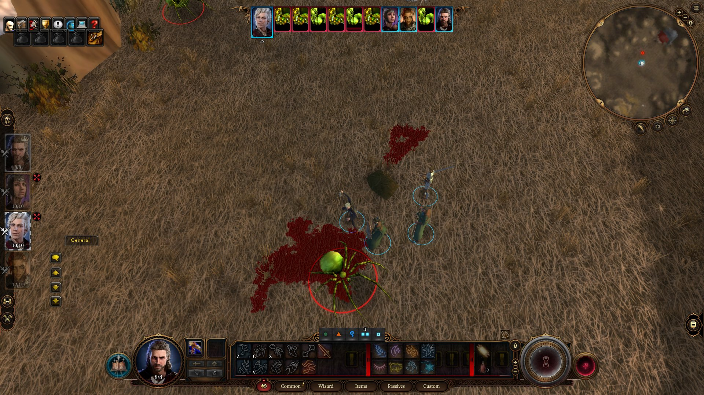

# WOW-BG3

Play vanilla World of Warcraft (1.12.1) as the world of a Baldur's Gate 3 game.

Your BG3 party walks WoW's world. WoW's mobs, NPCs, quests and loot are real WoW, served by a
local WoW server on your own machine; fights against WoW's mobs are BG3 fights with BG3's rules,
turns and spells. BG3 saves keep the WoW side too.

Linux only, with the native Linux build of BG3 from Steam. It needs your own WoW 1.12.1 client:
this project contains no Blizzard or Larian files.

> **State: very much a work in progress.** 0.1.0 is a first playable beta. You can make a character,
> walk Elwynn Forest, fight its mobs, quest, loot, trade, level up and recruit companions, but a lot
> is untested, unbalanced or not built yet. [What is work in progress](#work-in-progress) lists it
> honestly; read it before you start a long game.

## The goal

A fully playable WoW 1 to 60 experience with the BG3 characters and BG3's combat: WoW's world,
quests, items, zones and progression, played with BG3's party, turn-based fights, spells, dialogue
of the companions and its look. WoW's stats and mechanics are mapped onto BG3's: most of it by
broad automatic rules (items, mobs, health, levels), and some of it hand-made where a rule cannot
do a thing justice, dungeon bosses for example.

After that: multiplayer, and then The Burning Crusade and Wrath of the Lich King once the vanilla
version is mostly complete.

## How it plays

- **Starting.** Enable WOW-BG3 in BG3's mod manager and start a New Game. Make or pick your
  character in BG3's character creation; you land in the WoW start zone of your character's race.
- **Exploring.** BG3's camera, controls and interface; WoW's world under your feet, with WoW's
  NPCs, mobs, day and night. WoW's chat, quest log and quest tracker sit beside BG3's interface.
- **Fighting.** Walk into a WoW mob (or attack one) and a BG3 fight starts: the mob is held on the
  WoW server and fights as a BG3 creature, turn by turn, with BG3's rules. When the fight ends the
  result goes back to WoW as real damage, XP, loot and quest credit.
- **Looting.** A WoW corpse opens BG3's own loot window with that mob's WoW loot and gold.
- **Questing and NPCs.** Talking to a quest giver, or to any NPC with WoW dialog, opens WoW's own
  quest and gossip windows, as in vanilla: accept, decline and hand in there. Vendors open BG3's
  trade screen with the vendor's WoW wares. A left click on a friendly NPC talks to it while you
  walk and pickpockets it while you sneak; NPCs with nothing to say in WoW (guards, villagers) offer
  no Talk. A robbed NPC and its neighbours search around where you stood before going back to their
  posts.
- **Money.** WoW's copper is BG3's gold: 1 copper = 1 gold, so 1 silver = 100 gold and 1 WoW gold
  = 10,000 gold. Prices and corpse money use the same rule.
- **Saving.** Save and load as in BG3; loading a save takes the WoW character back to where it was
  in that save. World mode only happens in games started with WOW-BG3 enabled: a save made without
  it plays as plain BG3, and WOW-BG3 says so in a message box when you load one.

## Your character in WoW

A hidden WoW character follows your BG3 character, made for you at the first start (no WoW account
or login is needed: everything is local). Its race, and with it the start zone and the faction,
come from your BG3 race:

| BG3 race | WoW race | Faction | Start zone |
|---|---|---|---|
| Human, Half-Elf, Halfling | Human | Alliance | Northshire (Elwynn Forest) |
| Elf, Drow | Night Elf | Alliance | Shadowglen (Teldrassil) |
| Dwarf | Dwarf | Alliance | Coldridge Valley (Dun Morogh) |
| Gnome | Gnome | Alliance | Coldridge Valley (Dun Morogh) |
| Half-Orc | Orc | Horde | Valley of Trials (Durotar) |
| Githyanki | Troll | Horde | Valley of Trials (Durotar) |
| Tiefling | Undead | Horde | Deathknell (Tirisfal Glades) |
| Dragonborn | Tauren | Horde | Camp Narache (Mulgore) |

The WoW class follows your BG3 class where vanilla allows that race and class together, and
otherwise the closest one it does allow (Warrior is legal for every race):

| BG3 class | WoW class | Where vanilla does not allow it |
|---|---|---|
| Barbarian, Fighter, Monk | Warrior | |
| Ranger | Hunter | Warrior for Human, Gnome and Undead |
| Rogue, Bard | Rogue | Warrior for Tauren |
| Cleric | Priest | Shaman for Orc and Tauren, Warrior for Gnome |
| Wizard, Sorcerer | Mage | Warlock for Orc, Warrior for Night Elf, Dwarf and Tauren |
| Warlock | Warlock | Warrior for Night Elf, Dwarf, Troll and Tauren |
| Druid | Druid (Night Elf, Tauren) | Shaman for Orc and Troll, Priest for Human, Dwarf and Undead, Warrior for Gnome |
| Paladin | Paladin (Human, Dwarf) | Shaman for Orc, Troll and Tauren, Warrior for the rest |

The WoW class matters little in play: your party fights with its BG3 classes.

Northshire and Elwynn Forest are where it has been played most; the other start zones, the Horde
side above all, have had little or no testing.

## Levelling

BG3's own XP is off. Your **WoW** character earns XP the WoW way (kills, quests, exploration; the
local server runs at normal WoW rates), and WoW levels turn into BG3 levels:

| WoW level | What you get |
|---|---|
| 1 | Your character alone |
| 2, 3, 4 | One more party slot each: a party of four at WoW level 4 |
| 5 to 64 | One BG3 level-up each, 60 in all |

Each WoW level from 5 on puts one BG3 level-up into a **pool**. While the pool holds one, BG3's own
Level Up button shows on every party member who can take it; level whichever one you want (every
class choice is yours), and the others' buttons go once the pool is empty. So members sit at different
BG3 levels on purpose. 60 level-ups take a party of four from BG3 level 1 to 16, so **WoW 64 is a party
of four at BG3 level 16**. Vanilla WoW stops at level 60 today, so the last four wait for a higher WoW
cap.

BG3's XP bar on your character shows how far you are into your current WoW level.

- BG3 itself stops at level 12. Levels 13 and up need a level-cap mod, which WOW-BG3 does not
  bundle and has not tested (for example Expansion Level 13-20 (Configurable) and 5e Spells); without
  one, level-ups past 12 stay in the pool.
- A dismissed companion keeps its BG3 levels and rejoins at them; the pool counts them as spent. Only
  Withers' respec (`/wowbg3 respec NAME`) gives level-ups back.
- Planned: WoW levels 61 to 64 on the server, and new abilities for the classes past BG3's own.

## Commands

Type them in WoW's chat, one word each: `/wowbg3 help` lists them.

| Command | What it does |
|---|---|
| `/wowbg3 list` | The party and where everyone is |
| `/wowbg3 add NAME` | Recruit a companion: shadowheart, astarion, laezel, wyll, karlach, gale, jaheira, minsc, halsin, minthara |
| `/wowbg3 remove NAME` | Dismiss a companion (it keeps its BG3 levels) |
| `/wowbg3 pool` | Your WoW level, party slots and BG3 level-ups left |
| `/wowbg3 respec NAME` | Withers' respec: back to BG3 level 1, its level-ups back to the pool |
| `/wowbg3 chat on`, `off` | Show or hide WoW's chat |

Test commands, on in this beta (`debug_commands = 1` in `Mods/WOW-BG3/settings.conf`; 0 turns them off):

| Command | What it does |
|---|---|
| `/wowbg3 refill` | HP, spell slots, rage and the rest back to full |
| `/wowbg3 tp PLACE`, `tp ZONE X Y`, `tp X Y` | Move on the WoW map (X and Y from 0 to 100, as on WoW's map) |
| `/wowbg3 where`, `find TEXT` | Where you are; search zones and named places |
| `/wowbg3 faction horde`, `alliance`, `own` | Your WoW side |
| `/wowbg3 level N` | Set your WoW level, 1 to 60 (it fills the pool: BG3's Level Up shows on the party) |
| `/wowbg3 xprate N` | The server's XP rate (1 is normal) |

## Install

Download `WOW-BG3-<version>.zip` from this repository's Releases page; the README in it has every
step. In short:

1. You need BG3 (native Linux build, Steam), your own WoW 1.12.1 client (build 5875, English) and
   about 10 GB of free disk space for the server data built from it.
2. Put `WOW-BG3.pak` and the `WOW-BG3/` folder side by side into BG3's Mods folder
   (`~/.local/share/Larian Studios/Baldur's Gate 3/Mods`).
3. Copy your WoW 1.12.1 client files into `Mods/WOW-BG3/WoW/` (so `Mods/WOW-BG3/WoW/Data/` exists).
4. With Steam closed, run once:
   `python3 ~/.local/share/"Larian Studios/Baldur's Gate 3/Mods/WOW-BG3/bg3le/install.py"`.
   It installs the Linux Script Extender (bg3le) with WOW-BG3's patches and sets BG3's Steam launch
   option. It still runs your other Script Extender mods; `--uninstall` undoes it.
5. Start BG3, enable WOW-BG3 in the mod manager, start a New Game.

The first start takes a few minutes: the local WoW server builds its data from your WoW files while
BG3's loading screen waits. Later starts and loads take under a minute. Switching WOW-BG3 off in the
mod manager stops the whole WoW side.

To update, replace `WOW-BG3.pak` and `WOW-BG3/` with the new ones (keep your `WoW/` folder and your
`settings.conf`) and run the installer again. Your saves and `~/.local/share/wow-bg3/` stay.

More: [docs/install.md](docs/install.md). Known issues of this version:
[docs/known-issues.md](docs/known-issues.md).

## Work in progress

What works is listed above; this is what does not, or has not been tried:

- **Balance and pacing are a first guess.** The numbers that map WoW's mobs, health, damage, levels
  and XP onto BG3's were set by hand to make things playable, not tuned. A BG3 level 1 character
  out-damages a level 4 WoW human today, and the 1 to 60 pace is unknown.
- **Most of the play so far was in Elwynn Forest.** Dungeons have not been tested at all, nor has a
  party spread across zones or continents; the other start zones and the Horde side have had little
  or no testing.
- **Changing characters.** Recruiting, dismissing and swapping companions only works through the
  commands (`add`, `remove`) for now.
- **Item mapping.** Every WoW item becomes a BG3 item by rule: a weapon keeps its BG3 base's damage
  die and gains +1 to +3 from its WoW damage per second, armour gets BG3-style AC from its WoW armour
  type and item level, and WoW stats become ability and resistance bonuses. WoW slots BG3 has none for
  (shoulders, legs, waist, trinkets and the rest) are carried as "Worn in WoW" items you can only equip
  on the WoW side. Random suffixes, on-equip and on-use effects, durability, repair, buyback and bags
  as BG3 containers are not mapped, and a WoW consumable uses BG3's own effect rather than WoW's spell.
- **Health and ability mapping.** Your party is pure BG3: BG3 health, spells, saves and proficiency,
  with WoW gear adding AC and ability bonuses. A WoW mob fights as the nearest BG3 creature, with that
  creature's own BG3 health at the WoW mob's health fraction; only its damage is scaled to WoW's.
- **The level cap**: BG3 stops at 12 without a level-cap mod (see [Levelling](#levelling)).
- **Indoors.** Nothing cuts away a WoW roof or wall between the camera and your party, so in houses
  and caves the camera pushes against the building instead of looking through it.
- **Cloth and models.** BG3's cloth simulation is not carried onto WoW's picture, so a robe or heavy
  armour trails behind the character and can clip.
- **Terrain.** Some ground is walkable in BG3 where WoW would stop you, like some steep hills and
  slopes, so the party can get to places a WoW character cannot.
- **Spell effects.** Some spells' visual effects are missing or only partly drawn on WoW's picture: the
  spell still works by BG3's rules, you just do not see all of it.
- **Picture.** Enemy vision cones show on WoW's ground while you sneak, but their edges are ragged
  where WoW's ground and BG3's idea of it disagree in height; ground surfaces can look matte, and WoW's
  minimap and map icons are not drawn.
- **Saves and death.** A save made during a fight cannot resume that fight yet: after the load the
  fight is ended where everyone stands. Dying outside a fight (a fall, a surface) does not yet kill
  your WoW character.

Each of these in detail, with the smaller ones: [docs/known-issues.md](docs/known-issues.md).

## Planned

- **Withers in every graveyard**, for respecs and for raising fallen companions, and **the Guardian
  as an NPC in the major cities and start zones**, to recruit, swap and change companions in game
  (together with fixing what happens to the levels of a swapped companion).
- **Equipment with more interesting effects** than stats: WoW's on-equip and on-use effects, and
  hand-made ones where a rule falls short.
- **Hand-made content where rules are not enough**, dungeon bosses first.
- **Waypoints**: BG3's fast-travel waypoints placed at WoW's flight points.
- **Proper balance and pacing** for the whole 1 to 60 journey.
- **BG3 level 16** with new class abilities (see [Levelling](#levelling)).
- **Multiplayer**, then **The Burning Crusade** and **Wrath of the Lich King** once vanilla is mostly
  complete.

### Open question: resting

BG3 refills spell slots and health with short and long rests at camp; WoW has no camp, only eating,
drinking and resting at inns. Two ways to bring them together, and opinions are welcome (open an
issue):

1. **Camp and sleeping**, as in BG3: a long rest anywhere outside a fight takes the party to camp.
   Withers and the Guardian would then live at camp instead of in graveyards and cities.
2. **WoW's way**: drinking (mana potions, water) refills spell slots and eating heals, with no camp.

Until then, the `refill` test command does a long rest's work.

**Work in progress: camp is off for now.** Going to camp (and leaving it) breaks the WoW world for a
while, so camp travel is turned off until the question above is settled. Use `/wowbg3 refill`
instead of a long rest.

## Good to know

- **Other mods.** WOW-BG3 runs beside other BG3 mods and Script Extender mods, but it has only been
  tested alone. Mods that change levels, XP, rests or the party size are the likeliest to clash.
- **Your saves.** Saves made without WOW-BG3 stay plain BG3 games and stay loadable; back them up
  before you try a beta anyway.
- **Uninstall.** Switch WOW-BG3 off in the mod manager (the WoW side then stops at once), run the
  installer with `--uninstall` to take the Script Extender back out of BG3's launch options, and
  remove `Mods/WOW-BG3.pak`, `Mods/WOW-BG3/` and `~/.local/share/wow-bg3/`.
- **When something goes wrong.** The logs are in `~/.local/share/wow-bg3/logs/` (the WoW side) and
  `~/.local/share/bg3le/logs/` (BG3's side). Please attach both to a bug report, with what you did
  just before.

## Credits

WOW-BG3 stands on [vmangos](https://github.com/vmangos/core) (the WoW server),
[benilla](https://github.com/samwhosung/benilla) (the WoW client) and
[bg3le](https://github.com/lenonk/bg3le) (the Linux Script Extender), each patched for this project
(`patches/`).

## Build from source

Every part of the release zip is built from this repository plus pinned upstream sources:
`release/build-all.sh VERSION`. What it needs and what each step does:
[docs/build.md](docs/build.md).

## How it works

BG3 is the game you see and control. A hidden WoW client (benilla, a WoW 1.12.1 client written in
Rust) runs offscreen and logs in to a local vmangos server; its picture of the world is drawn behind
BG3's characters, and BG3 walks on WoW's ground. When a fight starts, the server holds the mobs and
BG3 fights them as stand-ins; the result goes back to the server as real WoW damage, XP, loot and
quest credit. Details: [docs/architecture.md](docs/architecture.md).

| Folder | What it is |
|---|---|
| `mod/` | The BG3 mod (Script Extender Lua, `meta.lsx`), packed into `WOW-BG3.pak` |
| `plugins/` | bg3le native plugins: the launcher, the main plugin (`wowbg3.so`), the render plugin, the quest cursor plugin; `plugins/capture/` is the render code they share |
| `bridge/` | The fight bridge (Rust crate `wow-bg3-link`) between BG3's fights and the WoW server |
| `tools/` | The Python tools the release runs: coordinator, save sync, world, inventory and chat bridges, data generators |
| `wow-addon/` | The WoW interface addon used in world mode |
| `server/` | The portable WoW server: start script and build scripts |
| `patches/` | Patches to the upstream projects WOW-BG3 builds: bg3le, benilla, vmangos (each under its upstream licence) |
| `release/` | The release build: zip builder, player README, launcher config, licence collector, build settings |
| `docs/` | Install, build, architecture, known issues |
| `LICENSES/`, `THIRD-PARTY-NOTICES.md` | Licences of the bundled third-party parts |

## Licence

WOW-BG3's own code is under the MIT licence ([LICENSE](LICENSE)). The patches in `patches/` are
under the licence of the project they patch (see the README in each folder), and the programs the
release bundles keep their own licences ([THIRD-PARTY-NOTICES.md](THIRD-PARTY-NOTICES.md)). bg3le's
Script Extender part carries the Commons Clause: WOW-BG3 releases may not be sold.

WOW-BG3 is not affiliated with or endorsed by Blizzard Entertainment or Larian Studios. World of
Warcraft is a trademark of Blizzard Entertainment, Inc.; Baldur's Gate is a trademark of its owner
(Wizards of the Coast, whose game Larian Studios develops). This project contains no Blizzard or
Larian files.
